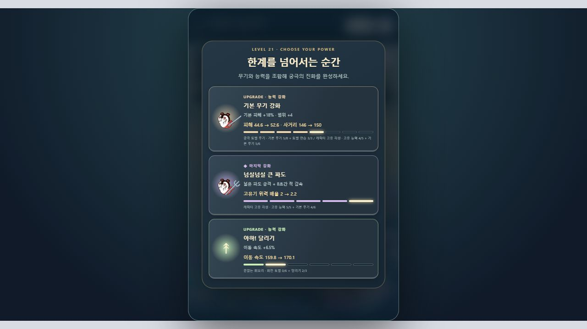
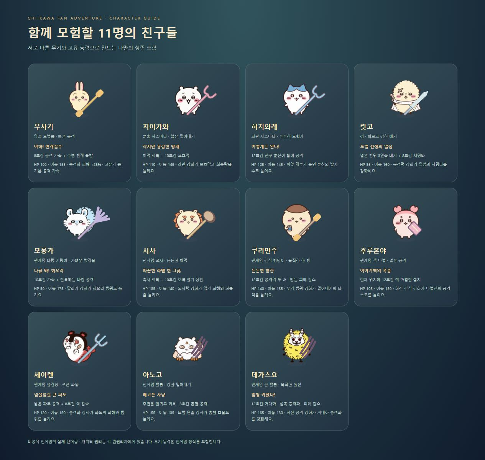
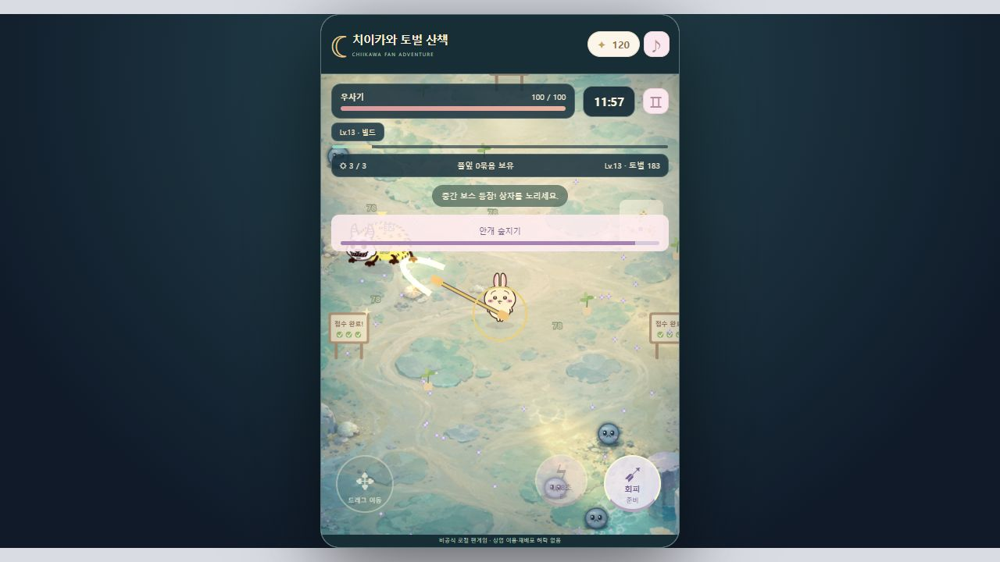
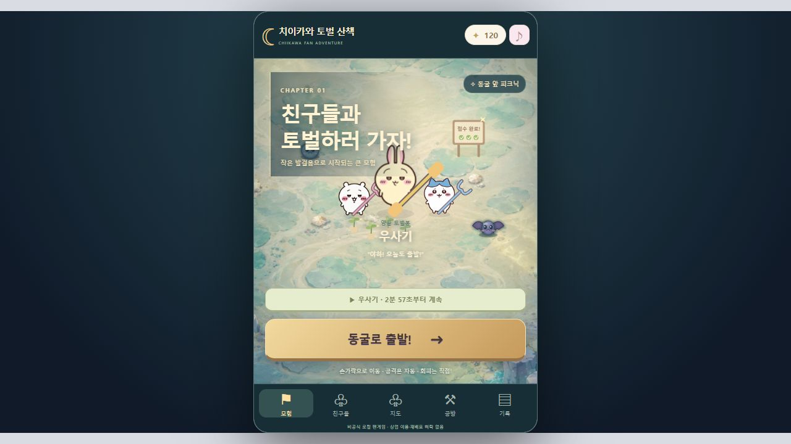

# Chiikawa Survivors · 치이카와 토벌 산책

**작은 친구들과 15분 동안 살아남는, 치이카와 비공식 팬 생존 액션 게임.**

한 손 이동과 자동 공격을 바탕으로 무기를 강화하고, 캐릭터 고유기와 보조 능력을 조합해 최종 진화에 도달합니다. Vampire Survivors의 생존·성장 흐름에서 모티브를 얻었으며, 원작 게임의 코드나 에셋을 사용하지 않았습니다.

> **로컬 팬게임 시제품입니다.** 캐릭터 원본 스프라이트는 재배포를 허용하지 않아 이 저장소에 포함하지 않았습니다. 아래 실행 준비와 [에셋 출처·이용 조건](docs/ASSETS.md)을 확인해 주세요. 공개 배포·상업적 이용 허락을 확보한 프로젝트가 아닙니다.

## 실제 플레이 화면

### 전투 · 이동 · 토벌


### 레벨업 · 강화 선택



로컬 브라우저에서 촬영한 실제 화면입니다. 화면 속 캐릭터 권리는 각 원권리자에게 있습니다.

## 주요 기능

- **15분 생존:** 시간에 따라 강해지는 무리, 정예 적, 중간 보스와 최종 보스.
- **11명 선택:** 체력·이동 속도·무기·고유기와 시너지가 다른 캐릭터.
- **근접 전투:** 토벌봉·사스마타·검 등의 자동 공격, 직접 사용하는 회피와 고유기.
- **12종 성장 능력:** 기본 무기, 공격력, 연사, 씨앗, 회전 간식, 회복, 속도, 범위, 회전 공격, 충격파, 도시락, 고유기.
- **최종 진화 6종:** 전투 중 조건을 채우면 자동 진화. 현재 빌드와 도감에서 조합 확인.
- **맵 3개:** 풀뽑기 들판, 동굴 앞 피크닉, 라멘 가게 가는 길.
- **풀잎 의뢰:** 풀잎 꾸러미를 모아 접수하고 경험치와 회복을 얻는 보조 목표.
- **중간 저장:** 5초 주기 자동 저장, 저장 후 로비 복귀, 새로고침 후 이어하기.
- **로컬 진행:** 코인, 공방 강화, 캐릭터·맵 선택, 모험 기록 저장.
- **외부 서버 없이 실행:** 로그인·광고 SDK·실제 결제·외부 분석 전송 없음.

## 실행 방법

### 1. 준비

- Node.js **18 이상**. 개발·검증 환경은 Node.js 24입니다.
- Windows / macOS / Linux의 최신 브라우저.
- 처음 캐릭터 파일을 준비할 때만 인터넷 연결이 필요합니다.
- 별도의 npm 패키지를 설치할 필요가 없습니다.

```bash
git clone https://github.com/gittaeo/Chiikawa_Survivors.git
cd Chiikawa_Survivors
```

### 2. 캐릭터 파일 준비

먼저 [원본 저장소의 저작권 안내](https://github.com/heelee912/chiikawa-dots-pets#저작권-안내)를 확인합니다. 로컬 팬게임 실행용 파일은 아래 명령으로 원본 출처에서 받을 수 있습니다.

```bash
node scripts/fetch-assets.mjs
```

또는 `npm run assets:fetch`를 사용합니다. 고정된 원본 리비전에서 PNG 11개를 받고 규격을 검증합니다. 이미 정상 파일이 있으면 다시 받지 않습니다. **다운로드 파일을 다시 커밋·공개 호스팅·릴리스 ZIP에 포함하지 마세요.**

직접 준비하려면 각 캐릭터의 원본 `pets/{id}/spritesheet.png`를 `assets/chiikawa/{id}.png`에 배치합니다.

### 3. 게임 시작

```bash
node server.cjs
```

브라우저에서 **[http://localhost:4173](http://localhost:4173)** 을 엽니다. 또는 `npm start`를 사용합니다. 종료는 터미널에서 `Ctrl+C`입니다.

서버는 `127.0.0.1`에서만 수신합니다. 기본 설정으로 다른 휴대폰이나 외부 네트워크에 공개되지 않습니다. HTML을 파일 탐색기에서 직접 열기보다 로컬 서버를 사용해 주세요.

## 조작

| 동작 | PC | 터치 화면 |
|---|---|---|
| 이동 | WASD / 방향키 | 화면을 누르고 드래그 |
| 기본 공격 | 가까운 적에게 자동 공격 | 자동 공격 |
| 회피 | Space | 회피 버튼 |
| 캐릭터 고유기 | E | 고유기 버튼 |
| 일시 정지 | Esc / 정지 버튼 | 정지 버튼 |
| 빌드·진화 조건 | 전투 중 빌드 버튼 | 빌드 버튼 |

성장 능력을 고르는 동안 전투 시간은 멈춥니다. 창을 숨기면 자동 일시 정지합니다.

## 15분 한 판의 흐름

| 시간 | 진행 |
|---|---|
| 0~3분 | 풀잎 의뢰·경험치 획득·초기 무기 강화 |
| 3분 | 첫 중간 보스 |
| 6 / 9 / 12분 | 중간 보스와 점점 강해지는 무리 |
| 14분 | 최종 보스 등장 |
| 15분 | 최종 보스 처치 + 생존 시 승리 |

중간 보스가 남기는 상자는 흩어진 경험치를 회수하고 추가 경험치·회복을 제공합니다. 풀잎 의뢰는 필수 승리 조건이 아닌 성장 보조 목표입니다. 최종 보스를 일찍 잡아도 마지막까지 살아남아야 합니다.

## 캐릭터 11명

아래는 최신 게임 렌더러로 촬영한 11명 캐릭터 도감입니다. 무기·고유기·시너지를 함께 확인할 수 있습니다. **전투 수치와 고유기는 팬게임용 창작**입니다.



로컬 실행 후 [캐릭터 도감](http://localhost:4173/characters.html)에서도 볼 수 있습니다.

| 캐릭터 | 기본 무기 모티브 / 팬게임 무기 | 고유기 |
|---|---|---|
| **우사기**<br><code>usagi</code> | 양끝 토벌봉 | **야하! 번개질주**<br>8초간 공격 가속 + 주변 번개 폭발 |
| **치이카와**<br><code>chiikawa</code> | 분홍 사스마타 | **작지만 용감한 방패**<br>체력 회복 + 10초간 보호막 |
| **하치와레**<br><code>hachiware</code> | 파란 사스마타 | **어떻게든 된다!**<br>12초간 친구 분신이 함께 공격 |
| **랏코**<br><code>rakko</code> | 검 | **토벌 선생의 일섬**<br>넓은 범위 3연속 베기 + 8초간 치명타 |
| **모몽가**<br><code>momonga</code> | 팬게임 바람 지팡이 | **나를 봐! 회오리**<br>10초간 가속 + 반복하는 바람 공격 |
| **시사**<br><code>shisa</code> | 팬게임 국자 | **따끈한 라멘 한 그릇**<br>즉시 회복 + 10초간 회복·열기 장판 |
| **쿠리만주**<br><code>kurimanju</code> | 팬게임 간식 방망이 | **든든한 한잔**<br>12초간 공격력 두 배 · 받는 피해 감소 |
| **후루혼야**<br><code>furuhonya</code> | 팬게임 책 마법 | **이야기책의 폭풍**<br>현재 위치에 12초간 책 마법진 설치 |
| **세이렌**<br><code>siren</code> | 팬게임 물결창 | **넘실넘실 큰 파도**<br>넓은 파도 공격 + 8초간 적 감속 |
| **아노코**<br><code>anoko</code> | 팬게임 발톱 | **배고픈 사냥**<br>주변을 할퀴고 회복 · 8초간 흡혈 공격 |
| **데카츠요**<br><code>dekatsuyo</code> | 팬게임 큰 발톱 | **엄청 커졌다!**<br>12초간 거대화 · 접촉 충격파 · 피해 감소 |

### 캐릭터별 시너지

| 캐릭터 | 강화 조합의 효과 |
|---|---|
| 우사기 | 충격파 피해 +25% · 고유기 중 기본 공격 가속. |
| 치이카와 | 라멘 강화가 보호막과 회복량을 늘려요. |
| 하치와레 | 씨앗 개수가 늘면 분신의 발사 수도 늘어요. |
| 랏코 | 공격력 강화가 일섬과 치명타를 강화해요. |
| 모몽가 | 달리기 강화가 회오리 범위도 늘려요. |
| 시사 | 도시락 강화가 열기 피해와 회복을 늘려요. |
| 쿠리만주 | 무기 범위 강화가 밀어내기와 타격을 늘려요. |
| 후루혼야 | 회전 간식 강화가 마법진의 공격 속도를 높여요. |
| 세이렌 | 충격파 강화가 파도의 피해와 범위를 늘려요. |
| 아노코 | 토벌 연습 강화가 흡혈 효율도 늘려요. |
| 데카츠요 | 회전 공격 강화가 거대화 충격파를 강화해요. |

## 무기 강화와 최종 진화

- 기본 무기 최대 **8단계**, 캐릭터 고유기 최대 **5단계**, 나머지 능력 최대 **6단계**.
- 최대 강화된 능력은 레벨업 후보에서 제외됩니다.
- 아래 두 조건을 충족하면 자동으로 진화하며 중복 적용되지 않습니다.
- 모든 강화 단계를 채운 뒤에는 선택창 없이 자동 한계 돌파가 적용됩니다.

| 최종 형태 | 조합 | 변화 |
|---|---|---|
| ⚔ **궁극 토벌 무기** | 기본 무기 Lv.8 + 토벌 연습 Lv.3 | 기본 무기 위력·범위 증가, 타격마다 빛의 파동 |
| ❧ **유성 씨앗 폭풍** | 씨앗 날리기 Lv.6 + 연속 찌르기 Lv.3 | 씨앗 수 2배 · 관통 3회 · 유성 탄환 |
| ◉ **무한 간식 결계** | 빙글 간식 Lv.6 + 도시락 Lv.3 | 커진 회전 결계 · 피해 감소 · 지속 회복 |
| ↻ **끝없는 회오리** | 회전 토벌 Lv.6 + 달리기 Lv.3 | 회전 공격 간격 절반 · 범위 대폭 증가 |
| ϟ **하늘을 가르는 번개** | 충격파 Lv.6 + 무기 범위 Lv.3 | 광역 번개 충격파 · 적 감속 |
| ✧ **캐릭터 고유 각성** | 고유 능력 Lv.5 + 기본 무기 Lv.6 | 고유 능력 위력·지속 시간 증가 · 재사용 단축 |

현재는 무기 슬롯 제한 없이 모든 조합에 도달할 수 있습니다. 캐릭터별 난도와 후반 밸런스는 플레이테스트를 통해 조정 중입니다.

## 저장과 이어하기

- 브라우저 로컬 저장소에 코인·공방 강화·선택 캐릭터·맵·최근 기록을 저장합니다.
- 진행 중 모험은 5초마다, 능력 선택/일시 정지/창 숨김 시 저장합니다.
- **일시 정지 → 저장하고 로비로 → 이어하기**로 중단한 판을 계속할 수 있습니다.
- 무기 단계, 진화, 고유기 상태, 적, 경험치, 보스 진행, 성장 선택 대기 상태도 복구합니다.
- **모험 그만두기**는 결과를 정산하고 이어하기 기록을 지웁니다.
- 브라우저 데이터 삭제나 다른 기기/프로필에서는 기록을 공유하지 않습니다. 저장소가 차단되어 있으면 화면에 경고가 표시됩니다.

## 개발과 검증

```bash
# 에셋 존재·PNG 해상도 검사 (다운로드 없음)
node scripts/fetch-assets.mjs --check

# 핵심 규칙 테스트
node --test tests/rescue.test.mjs

# 우사기·하치와레·치이카와의 15분 자동 경로 테스트
node tests/playthrough.mjs
```

현재 규칙 테스트 **21개**가 통과했습니다. 세 캐릭터의 고정 난수 자동 경로에서 15분 생존·최종 보스·6종 진화 도달을 확인했습니다. 자동 경로 결과는 사람의 재미·유지율·실제 클리어율을 의미하지 않습니다.

## 파일 구성

```text
index.html                  게임 화면과 메뉴
style.css                   세로 화면 UI
rescue-app.mjs              입력·렌더링·메뉴·저장 연결
rescue-engine.mjs           전투·성장·보스·승패·저장 복구
chiikawa-content.mjs        캐릭터·맵·성장 능력 데이터
progression.mjs             고유기·최대 단계·진화 조합
rescue-art.mjs              스프라이트 재생·무기·맵·효과
server.cjs                  로컬 전용 정적 서버
scripts/fetch-assets.mjs     원본 캐릭터 파일 로컬 준비
assets/chiikawa/             캐릭터 파일 — Git에서 제외
tests/                      규칙·전체 플레이 경로 테스트
docs/screenshots/           실제 게임 스크린샷
docs/ASSETS.md              출처·이용 조건
```

## 현재 범위와 다음 단계

현재 결과물은 **모바일 화면을 고려한 브라우저용 로컬 시제품**입니다. APK/AAB, Google Play 등록, 공개 웹 배포, 광고·결제 연동은 아직 없습니다. Android 실기기에서 장시간 성능·배터리·멀티터치를 검증하고, 외부 플레이어의 난도를 확인하는 단계가 남아 있습니다.

## 출처와 권리

- 캐릭터 원작: **치이카와 / 나가노 및 각 권리자**.
- 캐릭터 팬 스프라이트: [heelee912/chiikawa-dots-pets](https://github.com/heelee912/chiikawa-dots-pets).
- 무기·맵 소재 참고: [애니메이션 공식 사이트](https://www.anime-chiikawa.jp/), [공식 사스마타 상품 자료](https://chiikawamarket.jp/products/4970381627768).
- 코드의 전투 규칙, 무기 효과, UI, 맵 배치, 합성 효과음은 팬게임을 위해 작성했습니다. 애니메이션 음성·OST·영상 캡처는 포함하지 않습니다.

**원본 저장소는 상업적 이용과 재배포를 허락하지 않습니다.** 이 저장소 공개가 원작 IP나 팬 아트의 이용 권리를 부여하지 않습니다. 공개 배포·수익화에는 필요한 별도 허락 또는 독자 에셋으로의 교체가 필요합니다. 상세 내용은 [에셋 출처·이용 조건](docs/ASSETS.md)을 참고해 주세요.

## Visual update

The cavern stage now uses a generated overhead illustration, with teal lighting and a gold-accented interface. Upgrade cards show current and next combat stats, rank pips, evolution prerequisite progress, and a distinct treatment when the selected upgrade completes an evolution. Weapon and unique cards show the selected character.

Background: `assets/environments/moon-cavern.png`, generated with built-in ImageGen. Art direction: overhead magical island cavern, broad sandy jade combat floor, turquoise pools, lavender rocks, warm light shafts; no characters, UI, or lettering. This is a new game illustration, not an extracted animation frame.

The meadow also uses `assets/environments/golden-forest.png` (built-in ImageGen): overhead emerald island forest clearing, open moss-and-sand combat ground, golden sun rays, perimeter canopy and flowers; no text or characters. Camera view width increased from 500 to 580 world units without altering saved world coordinates.




## 시각 품질 개선

- 숲·동굴에 AI로 새로 제작한 게임 배경을 적용하고 카메라 시야를 넓혔습니다.
- 무기·능력 선택 카드에 캐릭터 그림, 실제 강화 전후 수치, 단계 표시, 진화 재료 진행도와 선택 효과를 추가했습니다.
- 몬스터 입체 음영, 박쥐 날갯짓, 정예 체력 표시, 공격 발광과 환경 입자를 추가했습니다.
- 로비·HUD·친구 목록·공방의 청록색/금색 테마를 통일했습니다.
- 검증: 단위 테스트 21개 통과, 우사기·하치와레·치이카와 15분 완주 및 6종 진화 확인.


